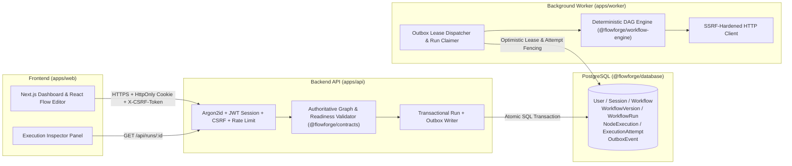

# FlowForge

**FlowForge** is a developer-focused visual workflow automation platform built with a TypeScript monorepo (`Next.js 15`, `React Flow`, `Express`, `PostgreSQL`, `Prisma`, and an asynchronous background worker). Users construct Directed Acyclic Graph (DAG) workflows in an interactive visual canvas, save work-in-progress drafts, publish immutable content-addressed versions, queue asynchronous execution runs through a transactional outbox, and inspect node-level execution timelines.

---

## Architecture Overview



---

## Core Capabilities

1. **Authentication & Session Security**:
   - Argon2id password hashing, `HS256` JWT session cookies (`HttpOnly`, `SameSite=Lax`, `Secure` in production), server-side `Session` revocation table (`jti`), HMAC-SHA256 Double-Submit CSRF protection (`X-CSRF-Token`), strict CORS origin allowlisting, and authentication rate limiting.
2. **Visual Workflow Editor & Safe Draft Persistence**:
   - Interactive `@xyflow/react` canvas supporting four node types: **Manual Trigger**, **HTTP Request**, **Condition** (`equals`, `not_equals`, `contains`, `exists` with `true`/`false` branch handles), and **Data Transform** (key-value path mappings).
   - **Corrupted Draft Protection**: If stored JSON contains malformed or unknown node/edge structures, the editor quarantines the invalid elements and locks saving until the user explicitly confirms **Recover & Repair Draft**, preventing silent data loss.
3. **Server-Authoritative Validation & Immutable Versioning**:
   - Separates **Draft Structural Validation** (`DraftDefinitionSchema` — allows saving work-in-progress nodes with incomplete fields while blocking cycles, duplicate IDs, invalid handles, or converging branches) from **Execution Readiness Validation** (`validateWorkflowExecutionReadiness` — requires exactly one `manual_trigger`, zero disconnected nodes, and complete node configurations).
   - Publishing (`POST /api/workflows/:id/publish`) canonicalizes the graph, computes a `SHA-256` `contentHash`, and creates an immutable `WorkflowVersion` record (`v1`, `v2`, ...).
4. **Durable Execution, Transactional Outbox & Worker Fencing**:
   - Triggering a run (`POST /api/workflows/:id/runs`) pins the exact `WorkflowVersion` and commits the `WorkflowRun`, initial `NodeExecution` rows, and an `OutboxEvent` in a single atomic transaction.
   - Supports client-supplied `idempotencyKey` (`X-Idempotency-Key` or body field) scoped to `(userId, workflowId)`.
   - Workers claim runs using expiring leases (`workerLeaseOwner`, `workerLeaseUntil`) and `attemptCount` optimistic concurrency checks so stale workers can never overwrite newer attempts or cancelled runs.
5. **SSRF-Hardened Outbound HTTP Client**:
   - Fails closed (`NODE_NOT_SUPPORTED`) by default unless `ENABLE_OUTBOUND_HTTP="true"`.
   - When enabled, blocks loopback (`127.0.0.0/8`, `::1`), RFC1918 private networks (`10/8`, `172.16/12`, `192.168/16`), link-local/cloud metadata (`169.254.169.254`, `100.100.100.200`, `fe80::/10`, `fc00::/7`), octal/hex/decimal IP encodings, and mixed DNS records. Pins the validated IP directly at the socket `lookup` layer to prevent DNS rebinding, blocks `3xx` redirects fail-closed, redacts sensitive headers, and enforces strict timeout (`10s`) and response size (`256 KB`) ceilings.

---

## Monorepo Structure

| Workspace | Path | Responsibility |
| :--- | :--- | :--- |
| `@flowforge/web` | `apps/web` | Next.js 15 App Router frontend, visual workflow editor, and execution inspector |
| `@flowforge/api` | `apps/api` | Express REST API, auth/CSRF middleware, workflow/version/run endpoints, outbox orchestrator |
| `@flowforge/worker` | `apps/worker` | Persistent background worker for outbox dispatch and workflow run execution |
| `@flowforge/contracts` | `packages/contracts` | Shared Zod schemas, graph contracts, readiness validator, and DTO types |
| `@flowforge/workflow-engine` | `packages/workflow-engine` | Deterministic DAG executor, safe data-path resolver, node handlers, SSRF-safe HTTP client |
| `@flowforge/database` | `packages/database` | Prisma schema, SQL migrations, and PostgreSQL client |
| `@flowforge/config` | `packages/config` | Shared TypeScript configuration |

---

## Quick Start

### Prerequisites
- **Node.js** `>= 20.0.0` (tested on `v24.11.0` and `v22.x`)
- **npm** `>= 10.0.0`
- **Docker & Docker Compose** (for local PostgreSQL 16 and Redis 7 containers)

### Setup & Run
```bash
# 1. Install dependencies from lockfile
npm ci

# 2. Copy environment variables
cp .env.example .env

# 3. Start PostgreSQL and Redis (requires Docker daemon running)
docker compose up -d

# 4. Generate Prisma Client and apply migrations
npm run db:generate
npm run db:migrate:deploy

# 5. Run verification suite (lint, typecheck, tests, build)
npm run lint
npm run typecheck
npm run test
npm run build

# 6. Start development servers (API on :4000, Web on :3000, Worker)
npm run dev
```

---

## Documentation Index

- [Architecture & Trust Boundaries](docs/ARCHITECTURE.md)
- [Local Development Guide](docs/DEVELOPMENT.md)
- [API Reference](docs/API.md)
- [Workflow Engine & Graph Contract](docs/WORKFLOW-ENGINE.md)
- [Security Model & SSRF Controls](docs/SECURITY.md)
- [Testing & Verification Matrix](docs/TESTING.md)
- [Operations & Queue Reliability](docs/OPERATIONS.md)
- [Deployment Guide](docs/DEPLOYMENT.md)
- [Release Readiness Verdict](docs/RELEASE-READINESS.md)
