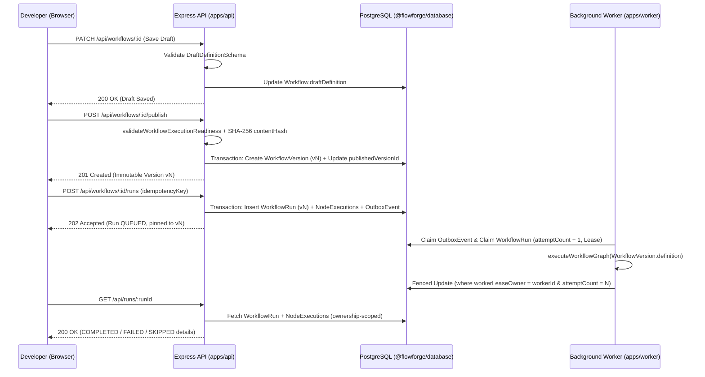

# FlowForge Architecture & Trust Boundaries

## 1. System Topology

FlowForge separates interactive authoring, API validation/persistence, and background workflow execution into distinct runtime boundaries inside a single TypeScript monorepo:

1. **Web Client (`apps/web`)**:
   - Next.js 15 App Router application serving the Workflows Dashboard (`/`) and the Visual Workflow Editor (`/workflows/[id]`).
   - Renders `@xyflow/react` nodes/edges, the node configuration panel, publish controls, and the **Execution Inspector** panel.
   - Communicates exclusively with `apps/api` over credentials-included HTTP requests with `X-CSRF-Token` headers.
2. **REST API (`apps/api`)**:
   - Express service enforcing authentication (`Argon2id` + `HS256` JWT session cookies backed by the PostgreSQL `Session` table), Double-Submit HMAC CSRF tokens, strict CORS origin allowlisting, and rate limiting.
   - Performs server-authoritative graph validation (`@flowforge/contracts`) on every draft save, publish request, and run creation request.
   - Never executes workflow graphs synchronously inside an HTTP request handler; instead, `POST /api/workflows/:id/runs` atomically writes a `WorkflowRun`, `NodeExecution` rows, and an `OutboxEvent` in a single PostgreSQL transaction.
3. **Background Worker (`apps/worker`)**:
   - Persistent background process independent of Next.js request lifecycles.
   - Claims eligible `OutboxEvent` rows using optimistic concurrency and timed leases (`lockedBy`, `lockedUntil`), claims the target `WorkflowRun` with attempt fencing (`workerLeaseOwner`, `workerLeaseUntil`, `attemptCount`), executes the pinned `WorkflowVersion.definition` via `@flowforge/workflow-engine` outside any open database transaction, and commits terminal node and run states atomically.
4. **Shared Packages**:
   - `@flowforge/contracts` (`packages/contracts`): Single source of truth for Zod schemas, graph validation, execution readiness validation, and canonical graph hashing.
   - `@flowforge/workflow-engine` (`packages/workflow-engine`): Deterministic topological DAG executor, safe data-path resolver, node handlers (`manual_trigger`, `condition`, `data_transform`, `http_request`), and the SSRF-hardened HTTP client.
   - `@flowforge/database` (`packages/database`): Prisma schema, forward SQL migrations, and PostgreSQL client.

---

## 2. Persistence & Version Pinning Data Flow

---

## 3. Trust Boundaries

| Boundary | Untrusted Input | Authoritative Control |
| :--- | :--- | :--- |
| **Browser $\rightarrow$ API** | Cookies, JSON bodies, URL params, `Origin`, `X-CSRF-Token`, `X-Idempotency-Key` | `helmet`, strict CORS origin set, `express.json({ limit: "1mb" })`, JWT signature + DB `Session` active check, HMAC CSRF verification, Zod schema parsing, `userId` ownership scoping on every query. |
| **Stored Draft JSON $\rightarrow$ Editor** | Legacy or manually corrupted `draftDefinition` JSON in DB | `normalizeDraftDefinition` flags `isCorrupted: true`; `WorkflowEditor` locks saving and displays a **Corrupted Draft Protection** banner until explicit user recovery. |
| **Draft $\rightarrow$ Published Version** | Incomplete or disconnected nodes in `draftDefinition` | `validateWorkflowExecutionReadiness` enforces 1 `manual_trigger`, 0 disconnected nodes, complete node configs, and canonical `SHA-256` hashing before creating `WorkflowVersion`. |
| **Worker $\rightarrow$ External HTTP Target** | User-configured `url`, `method`, `headers`, `body` on `http_request` nodes | Fail-closed by default (`NODE_NOT_SUPPORTED`). When enabled, `executeSafeHttpRequest` validates URL syntax, resolves and checks all DNS IPs against prohibited ranges, pins the validated IP in socket `lookup`, blocks `3xx` redirects, redacts sensitive headers, and enforces `10s` timeout and `256 KB` response limits. |
